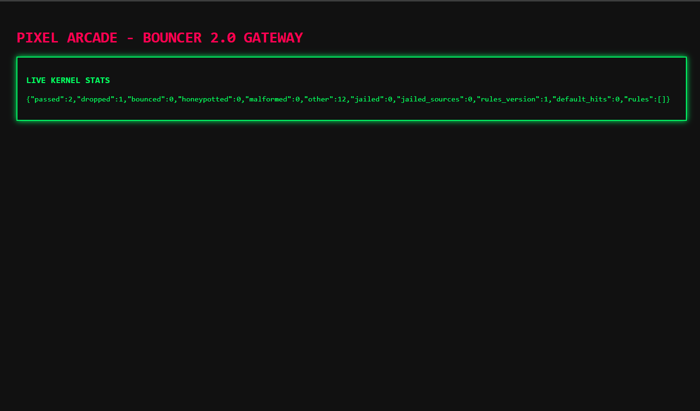

# Bouncer 2.0 (trafficcop) - eBPF/XDP Firewall

An in-kernel eBPF/XDP edge packet filter and control daemon built for the Low-Level Hackathon (CN01).

## Live Dashboard Preview


## Demo Video
-## 🎥 Demo Videos
- [Demo Video ](https://youtu.be/MDuNkAWl4wI?si=X7Lm8cuzbs7ksR0J)  
*(Direct File Link: [Watch video.mp4](video.mp4))*

## System & Environment Versions
- **Target OS:** Ubuntu 24.04 LTS (x86_64)[cite: 14]
- **Linux Kernel:** Linux 6.8+ (XDP Generic / Native hook support)[cite: 14]
- **eBPF Toolchain:** `clang` / `llvm` (`-target bpf`), `libbpf-dev`[cite: 14, 15]
- **User-Space Compiler:** `gcc` (C11, POSIX threads `-lpthread`)
- **Dashboard Port:** `127.0.0.1:8088` (`/` and `/stats.json`)

---
## How It Works
- **Kernel Data Path (`src/trafficcop_xdp.c`):** Intercepts packets at the XDP hook before `sk_buff` allocation. Parses Ethernet, 802.1Q VLAN tags, IPv4 headers (with variable IHL/options), and L4 TCP/UDP/ICMP headers. Enforces token-bucket rate limits, dynamic source jails, packet bouncing (`XDP_TX`), and rules matching.
- **Control Plane (`src/main.c`):** Validates `.rules` files, loads BPF maps, supports zero-downtime hot reloads (`trafficcop reload`), manages live jails (`jail`/`unjail`), and serves a real-time dashboard on `http://127.0.0.1:8088/` and `/stats.json`.

## Required APT Packages (Ubuntu 24.04)
- `clang`
- `llvm`
- `libbpf-dev`
- `linux-headers-$(uname -r)`
- `gcc`
- `make`
- `iproute2`
- `gcc-multilib`
- `lib32z1-dev`

## Repository Structure
```text
.
├── build.sh                  # Automated dependency installer & build script
├── bench.sh                  # Isolated network namespace & veth test bench
├── dashboard.png             # Live web dashboard screenshot
├── video.mp4                 # Project walkthrough & live demo recording
├── README.md                 # Project documentation
├── rules/
│   └── pixel-arcade.rules    # Sample firewall & rate-limiting policy
└── src/
    ├── common.h              # Shared kernel/user-space data structures
    ├── trafficcop_xdp.c      # eBPF/XDP kernel packet filter
    └── main.c                # User-space CLI daemon & HTTP dashboard server

## Build & Run
```bash
./build.sh
sudo ./trafficcop start <ifname> <rules_file>